<i>A system which rewires the model around the way you use it.</i>

<h1 align="center">HotRod</h1>

<h2 align="center">78 GB of model. 30 GB of RAM. 12 GB of VRAM. Zero cloud.</h2>

<b>A 125-billion-parameter AI on one gaming card, streaming from your SSD.</b> 
From <code>solid.cpp</code>, the learning ground, to <code>Strata-HotRod</code>, the engine.

🔥 <b>hot experts</b> on the card &nbsp;→&nbsp; 🌡️ <b>warm</b> in RAM &nbsp;→&nbsp; ❄️ <b>cold</b> on the SSD

  
  
  
  

  
  
  

  <a href="https://aao-is2.github.io/HotRod/">Write-up</a> ·
  <a href="#from-lesson-to-engine">Lessons</a> ·
  <a href="#how-fast">Speed</a> ·
  <a href="#how-a-token-is-served">How it works</a> ·
  <a href="#in-this-repository">Repository</a> ·
  <a href="#credit-and-license">Credit</a>

---

<table>
<tr>
<td align="center" valign="top" width="25%"><h2>🧊 78 – 111 GB</h2>of model on a <b>30 GB</b> PC (IQ3_S and UD-Q4_K_XL)</td>
<td align="center" valign="top" width="25%"><h2>🔥 17 → 50-70</h2>tokens/s on one RTX 3060: stock Strata to HotRod</td>
<td align="center" valign="top" width="25%"><h2>🐋 341 GB</h2>DeepSeek-V4.1-Flash on the same PC: 5–8 tokens/s</td>
<td align="center" valign="top" width="25%"><h2>⚡ 0.4 s</h2>to pick up a 45K-token conversation from its saved state</td>
</tr>
</table>

A mixture-of-experts model uses only a small slice of itself for each word, so a model far larger than the card can run if the
busiest slices sit on the card, the next busiest in RAM, and the rest on the drive. This repository documents how that was done
in two connected projects: **solid.cpp** (August to October 2026), a fork of llama.cpp used to find out what really works, and
**Strata-HotRod** (October to November 2026), which builds the lessons that survived measurement into
[Strata](https://github.com/Niko1221/Strata) by Niko1221 and contributors (MIT).

## The write-up

**[Open the illustrated write-up](https://aao-is2.github.io/HotRod/)**: an animated page showing how experts are placed, what
solid.cpp found, how each lesson became part of HotRod, the results and the install steps. Its source is
[`index.html`](index.html). A formal print copy for circulation, with the full references, is
[`HotRod-Technical-Note.pdf`](HotRod-Technical-Note.pdf).

## From lesson to engine

## How fast

Measured on one PC: RTX 3060 12 GB, i5-12400F, 30 GB RAM, NVMe. A token is about ¾ of a word. Every answer was read.

<table>
<tr>
<td valign="top" width="50%">

<table width="100%">
<tr><th align="left">Qwen3.8-Flash-Next IQ3_S 131K context, 24 Oct</th><th align="right">tokens/s</th></tr>
<tr><td align="left">Code (a function, 500-650 tokens)</td><td align="right">52 – 55</td></tr>
<tr><td align="left">Reasoning (~1,000 tokens)</td><td align="right">66 – 71</td></tr>
<tr><td align="left">Story (100-150 tokens)</td><td align="right">50 – 53</td></tr>
</table>

</td>
<td valign="top" width="50%">

<table width="100%">
<tr><th align="left">Stage, same PC</th><th align="right">tokens/s</th></tr>
<tr><td align="left">Stock Strata, 10 Oct (32K)</td><td align="right">17.2</td></tr>
<tr><td align="left">I/O prefetch on (test T1)</td><td align="right">27.2</td></tr>
<tr><td align="left">Stand-ins from rank 2 + draft head</td><td align="right">44.6</td></tr>
<tr><td align="left">Merged version (SPEC 20 step 9o)</td><td align="right">58.4</td></tr>
<tr><td align="left">Final, 24 Oct</td><td align="right">50 – 70</td></tr>
</table>

</td>
</tr>
</table>

The 111 GB UD-Q4_K_XL ran at 15–22 tokens/s (14 Nov, learners still cold). DeepSeek-V4.1-Flash (341 GB) ran at about 5
tokens/s on 31 Oct, and 7–8 over a whole answer per the branch README of 15 Nov. These rest on fewer runs than the 78 GB
result.

## How a token is served

## In this repository

| Folder | What it is |
|---|---|
| [`solid-cpp/`](solid-cpp) | The learning ground (Aug–Oct 2026): a llama.cpp fork with an MoE expert cache; the notes that record what worked and what did not |
| [`hotrod-qwen/`](hotrod-qwen) | Strata-HotRod for Qwen3.8-Flash-Next: [`SPEC.md`](hotrod-qwen/SPEC.md) (spec and test ledger), docs, tools, benchmarks, changed sources |
| [`hotrod-deepseek/`](hotrod-deepseek) | The port of the same ideas to DeepSeek-V4.1-Flash |
| [`HotRod-Technical-Note.pdf`](HotRod-Technical-Note.pdf) | The formal print copy of the write-up (8 pages, with references and the installation status); its source is in [`print/`](print) |
| [`CITATIONS.md`](CITATIONS.md) | Every project, paper, model, dataset and person credited |
| [`UPSTREAM.md`](UPSTREAM.md) | Exactly what is whose, with links to the base projects |

Start with [`hotrod-qwen/SPEC.md`](hotrod-qwen/SPEC.md), then
[`hotrod-qwen/docs/HOTROD-DETAILS.md`](hotrod-qwen/docs/HOTROD-DETAILS.md) (every change with its measurement) and
[`hotrod-qwen/docs/solid-page-vs-strata.md`](hotrod-qwen/docs/solid-page-vs-strata.md) (the two projects compared line by line).

**What this is not.** One PC, one card, one drive; AMD, Intel and Apple paths were not tested here. Figures are the author's
own measurements and have not been independently reproduced. The repository holds the changed files and the notes, not a
buildable copy: the base projects are linked in [`UPSTREAM.md`](UPSTREAM.md).

## Credit and license

HotRod is built on **[Strata](https://github.com/Niko1221/Strata) by Niko1221 and contributors** (MIT; about 3,600 commits of
this fork's history are Niko1221's), and solid.cpp on **[llama.cpp](https://github.com/ggml-org/llama.cpp)** by ggml-org and
contributors (MIT). The DeepSeek engine comes from **[Project Maya](https://github.com/mw00/project-maya)** by Peasant Smith
(mw00) and its contributors (MIT; its notice is kept in
[`hotrod-deepseek/third_party/project-maya`](hotrod-deepseek/third_party/project-maya)). The model is Qwen3.8-Flash-Next by the
Qwen team, compressed by ISTA-DASLab. The learned look-ahead uses the
[expert-trace dataset](https://huggingface.co/datasets/aswinkumar99/qwen3.8-flash-next-expert-traces) by aswinkumar99
(CC-BY-4.0). Prior art, 29 papers, models, benchmarks, bundled libraries and the contributors are all listed in
**[`CITATIONS.md`](CITATIONS.md)**.

The author's part: about 540 commits in solid.cpp, and about 630 (Qwen) and 120 (DeepSeek) on top of Strata, done with
Claude Code as an AI coding assistant. MIT licensed; upstream licences are kept ([`LICENSE`](LICENSE),
[`solid-cpp/LICENSE-llama.cpp`](solid-cpp/LICENSE-llama.cpp)).

